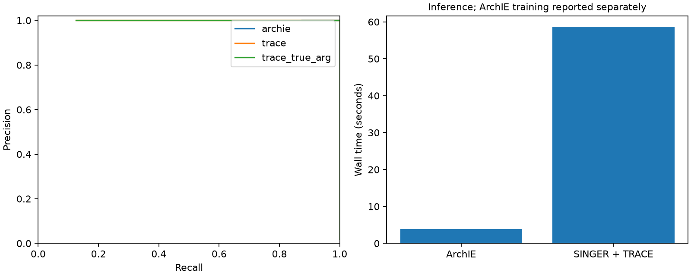

# Synthetic functionality run

This single run checks functionality; it does not establish comparative accuracy.

Parameters are software-validation settings, not mosquito estimates. All reported metrics use callable-base weighting on a common 50-kb grid. Windows with 30–70% true donor ancestry are reported separately.

| Method | Precision | Recall | F1 | Ambiguous windows |
|---|---:|---:|---:|---:|
| archie | 1.000 | 1.000 | 1.000 | 8 |
| trace | 1.000 | 1.000 | 1.000 | 8 |
| trace_true_arg | 1.000 | 1.000 | 1.000 | 8 |

One-time ArchIE training: 82.0 s. ArchIE inference: 3.8 s. SINGER plus TRACE inference: 58.7 s.

## Limitations

One seed is not a performance estimate. The short SINGER chain is a smoke test, not a convergence demonstration. ArchIE uses a comparison population and simulation-trained parameters; TRACE uses inferred genealogies. Their differing information requirements must be considered when interpreting performance. The true-ARG TRACE result is diagnostic and is not an empirical inference result.

## Empirical status

The mosquito pilot has not been run by this synthetic command. Empirical overlap is not an accuracy measurement.
